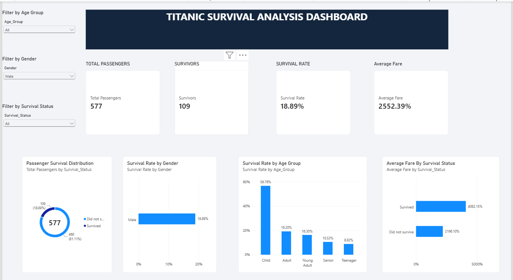

# Final Project: Titanic Survival Analysis

**Internship:** Data Analyst Internship  
**Organization:** SWYNEX Technologies  
**Tools:** Python, Pandas, Power BI, Power Query, DAX  
**Project Type:** Data Cleaning, Exploratory Data Analysis, and Interactive Dashboard

## 1. Problem Statement

The Titanic disaster resulted in the loss of many passengers' lives. This project aims to analyze passenger information and identify patterns associated with survival.

The main objective is to clean the dataset, perform exploratory data analysis, build an interactive Power BI dashboard, and communicate meaningful insights through visualizations.

## 2. Dataset Information

The project uses the Titanic passenger dataset.

- Total records: 891 passengers
- Original information includes passenger details such as age, gender, passenger class, ticket fare, cabin, and survival status.
- Target column: `Survived`
  - 0 = Did not survive
  - 1 = Survived

The cleaned dataset contains the columns:
`Survived`, `Name`, `Age`, `Ticket`, `Fare`, `Cabin`, and `Sex_male`.

## 3. Data Cleaning Process

The dataset was cleaned using Python and Pandas.

The following steps were performed:

1. Inspected the dataset structure and data types.
2. Checked for missing values and duplicate records.
3. Removed columns not included in the final analysis: PassengerId, SibSp, Parch, Pclass, and Embarked.
4. Filled missing Age values using the median.
5. Replaced missing Cabin values with "unknown".
6. Converted the Sex column into a numerical binary column using one-hot encoding (`Sex_male`).
7. Checked the final dataset for missing values and duplicates.

**Final data quality result:**
- Missing values: 0
- Duplicate records: 0

## 4. Exploratory Data Analysis

Exploratory Data Analysis was performed to understand survival patterns.

The analysis included:
- Overall passenger survival distribution.
- Survival rate by gender.
- Survival rate across different age groups.
- Average fare comparison between survivors and non-survivors.

### Key Analysis Results

| Metric | Result |
|---|---:|
| Total passengers | 891 |
| Survivors | 342 |
| Did not survive | 549 |
| Overall survival rate | 38.38% |
| Female survival rate | 74.20% |
| Male survival rate | 18.89% |
| Average fare of survivors | 48.40 |
| Average fare of non-survivors | 22.12 |

### Survival Rate by Age Group

| Age Group | Survival Rate |
|---|---:|
| Child | 57.97% |
| Teenager | 42.86% |
| Young Adult | 35.33% |
| Adult | 40.00% |
| Senior | 22.73% |

## 5. Power BI Dashboard

An interactive Titanic Survival Analysis Dashboard was created using Microsoft Power BI.

### Dashboard Components

- KPI cards: Total Passengers, Survivors, Survival Rate, and Average Fare.
- Donut chart: Passenger survival distribution.
- Bar chart: Survival rate by gender.
- Column chart: Survival rate by age group.
- Bar chart: Average fare by survival status.
- Interactive slicers: Gender, Age Group, and Survival Status.

**Dashboard Preview**

**Power BI File:** `SWYNEX_Task3_Titanic_Dashboard.pbix`

## 6. Key Business Insights

1. **Gender and survival:** Female passengers had a considerably higher survival rate (74.20%) than male passengers (18.89%).
2. **Age and survival:** Children had the highest survival rate among the analyzed age groups (57.97%), while senior passengers had the lowest (22.73%).
3. **Fare comparison:** Passengers who survived paid a higher average fare (48.40) than passengers who did not survive (22.12).
4. **Overall survival:** Only 38.38% of passengers survived, showing the severity of the disaster.
5. **Dashboard usability:** Interactive filters make it easier to explore passenger groups and compare survival patterns.

These are descriptive findings from the dataset and do not establish that any single factor caused survival.

## 7. Conclusion

This project demonstrates the complete data analytics workflow, starting with raw dataset inspection and cleaning, followed by exploratory data analysis and interactive dashboard development.

By using Python, Pandas, Power Query, DAX, and Power BI, I transformed passenger data into meaningful visual insights.

This project helped me strengthen my practical skills in data cleaning, data analysis, visualization, and communicating findings.

## 8. Project Links

- **Task 1 – Data Cleaning:** https://github.com/shehzll/swynex-task-1-data-cleaning
- **Task 2 – Exploratory Data Analysis:** https://github.com/shehzll/swynex-task-2-eda
- **Task 3 – Power BI Dashboard:** https://github.com/shehzll/swynex-task-3-dashboard

## 9. Acknowledgement

Completed as the final project of my Data Analyst Internship at SWYNEX Technologies.
